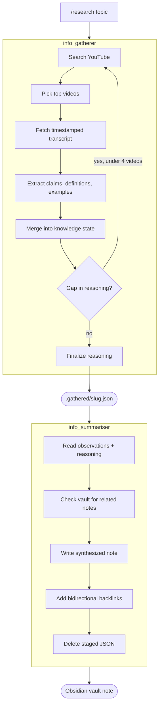

# yt-to-obsidian

Type a topic, get one synthesized note — sourced, cross-checked, and reasoned over from YouTube,
written straight into your Obsidian vault.


## Contents

- [Overview](#overview)
- [Architecture](#architecture)
- [Why this design](#why-this-design)
- [Prerequisites](#prerequisites)
- [Setup](#setup)
- [Usage](#usage)
- [Project structure](#project-structure)
- [Status](#status)
- [License](#license)

## Overview

Two [Claude Code](https://claude.com/claude-code) subagents do the work, chained by one slash
command:

- **`info_gatherer`** turns a topic into a YouTube search, picks a couple of relevant videos,
  extracts claims/definitions/examples with timestamps, then reasons over what it found —
  agreements, disagreements, and questions the sources didn't answer. If something concrete is
  still missing, it runs one more targeted search before finishing.
- **`info_summariser`** reads that structured knowledge, checks your vault for related notes, and
  writes one note in its own words — with tags, `[[wikilinks]]`, and bidirectional backlinks.

## Architecture



## Why this design

**The value over just watching the videos yourself:** a single LLM call asked to summarize "what
does the internet say about X" from its own training data can't cite anything, can't tell you when
two sources actually disagree, and can't tell you what it doesn't know. This pipeline grounds every
claim in a real video and timestamp, keeps disagreements as disagreements instead of flattening
them into false consensus, and explicitly tracks what the gathered evidence still can't answer —
then plugs the result into your own note graph (tags, wikilinks, backlinks) instead of leaving it
as a one-off answer you'll lose in a chat log.

**Why extraction and synthesis are separate steps, not one pass:** this is a knowledge-
representation choice made for cost, not just cleanliness. Raw transcripts get read exactly once,
during extraction, and are never re-read after that. `info_gatherer` converts each one into a small
structured object — claims with citations, definitions, examples — and discards the transcript
text immediately. `info_summariser` only ever holds those compact objects, never several full
transcripts at once. That's what lets both agents run on a cheap model tier (Haiku, by default —
see each agent's `model:` field) even for a multi-video topic: neither one needs thousands of words
of raw transcript sitting in context to do its job. Reasoning about agreement and disagreement
across sources happens over that same small merged object, too — comparing a handful of claim
strings, not diffing raw text.

## Prerequisites

- **Python 3.10+**
- **The [Claude Code CLI](https://claude.com/claude-code)** — this project *is* a set of Claude
  Code subagents and a slash command, not a standalone script. Clone the repo and run Claude Code
  with this folder open as your working directory, so it picks up `.claude/agents/` and
  `.claude/commands/`.
- **A folder to write notes into.** A real Obsidian vault if you want the graph view and backlinks
  to show up visually — but Obsidian itself isn't required to run the pipeline, any existing
  folder of markdown files works.

## Setup

1. Clone the repo and move into it:
   ```
   git clone https://github.com/Roi-san/yt-to-obsidian.git
   cd yt-to-obsidian
   ```
2. Install dependencies:
   ```
   pip install -r requirements.txt
   ```
3. Create your `.env` from the template, then edit it:
   ```
   cp .env.example .env        # macOS/Linux
   copy .env.example .env      # Windows (PowerShell/cmd)
   ```
   Set `OBSIDIAN_VAULT_PATH` to an **existing** folder:
   ```
   OBSIDIAN_VAULT_PATH=C:\Users\you\Documents\MyVault      # Windows
   OBSIDIAN_VAULT_PATH=/Users/you/Documents/MyVault        # macOS/Linux
   ```
   The pipeline won't create this folder for you — if `.env` is missing, the variable is unset, or
   the path doesn't exist, you'll get a clear message telling you exactly what to fix, the first
   time it tries to touch the vault.
4. Start Claude Code in this folder:
   ```
   claude
   ```

## Usage

From inside your Claude Code session:

```
/research how OAuth 2.0 authorization code flow works
```

Add a number to override the default 10-minute video-length cap:

```
/research <topic> 30
```

This writes one note into your vault, frontmatter and all:

```markdown
---
title: OAuth 2.0 Authorization Code Flow
created: 2026-08-04
tags: [oauth2, authorization, security, tokens]
sources:
  - https://youtube.com/watch?v=...
---

OAuth 2.0 is an authorization framework that enables applications to access protected
resources on behalf of users without requiring users to share passwords...

## The Authorization Code Grant Flow (Web Server Use)
...

## Open Questions
- What is the typical lifetime of authorization codes and access tokens, and how should they be managed?
...
```

## Project structure

```
.claude/
  agents/
    info_gatherer.md      # search -> extract -> reason, stages .gathered/<slug>.json
    info_summariser.md    # reads staged knowledge, writes the vault note
  commands/
    research.md           # the /research slash command
youtube_helpers.py         # search / transcript fetch / stage-knowledge / finalize-reasoning
vault_helpers.py           # vault list / skim / write / backlink
test_youtube_helpers.py
test_vault_helpers.py
```

## Status

v1.0 — the core pipeline is built and tested. Deliberately not built: relevance filtering beyond
the agents' own judgment, cross-vault duplicate detection (needs a vault with real size to design
against), and an actual Obsidian MCP server (`vault_helpers.py`'s functions are a plain internal
API on purpose, so wrapping them as MCP tools later is a small step, not a rewrite).

## License

MIT — see [LICENSE](LICENSE).
